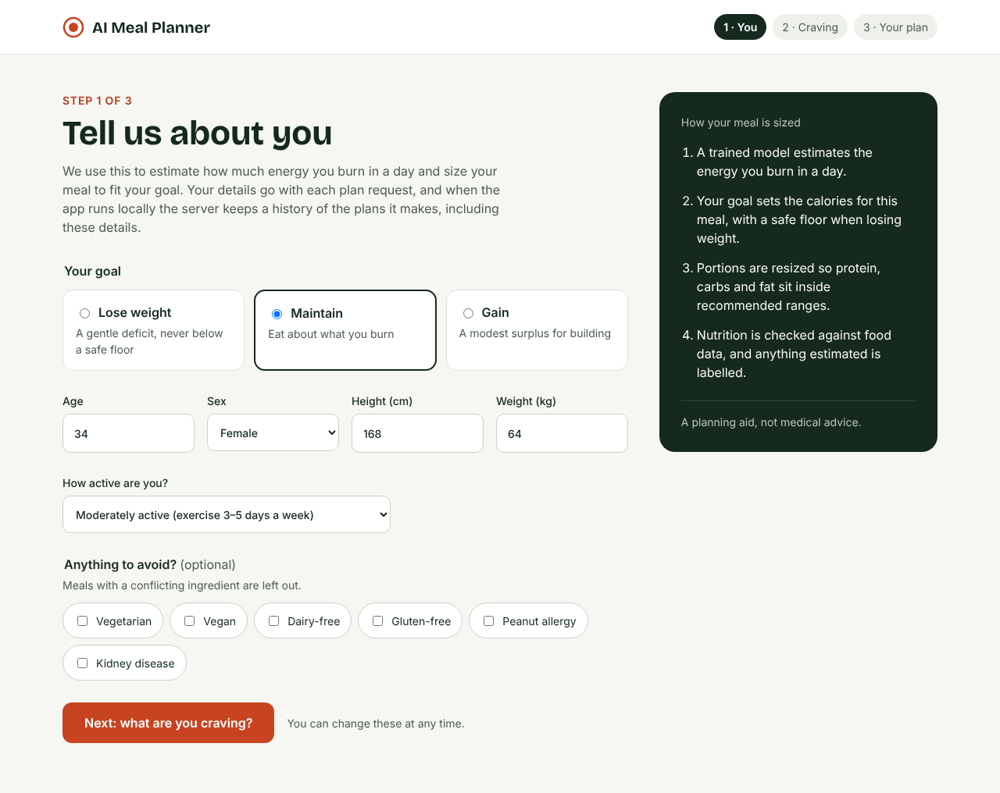
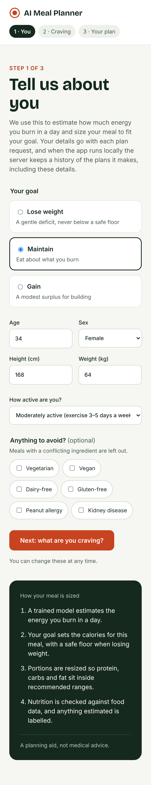
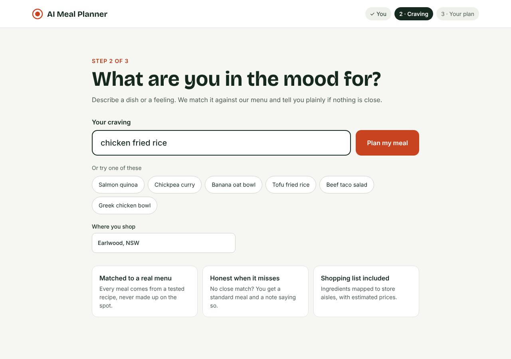
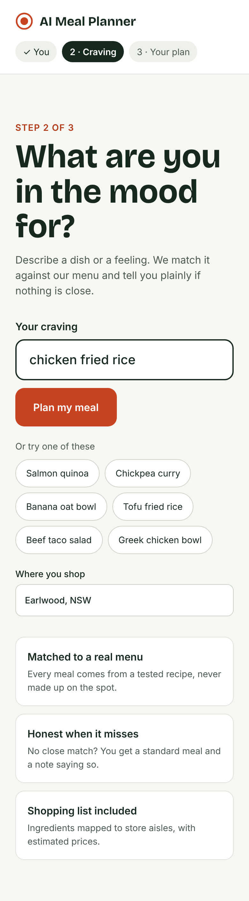
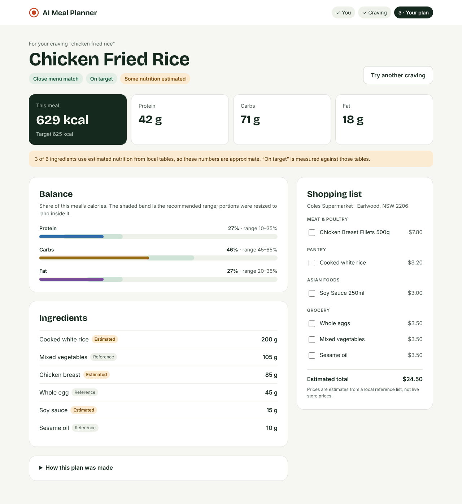
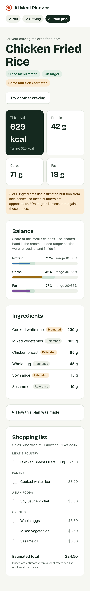

# Product Design — React showcase

**Status: proposal, revised after Codex's review (2026-10-21).** Nothing
here is built.
The owner and Codex review it in `docs/5_agent_log.md` first. Once it is
agreed, the decisions it settles go to `docs/3_decisions.md` and the work
moves into `docs/4_next_steps.md`.

The owner wants the React dashboard to become a proper web app, in the
spirit of the FarmLens showcase. The first target is a **polished local
showcase** (owner's choice, 2026-10-20), not a public app.

## 1. Goal and scope

Someone opens the app, says who they are and what they feel like eating,
and gets one meal they can trust plus a shopping list. Every number on
screen comes from the service and says how it was produced.

In scope:

- one guided flow in the React client: profile and goal, then craving,
  then the plan;
- a visual identity: name treatment, mark, colour, type and components;
- every state the API can return: matched, fallback, infeasible,
  rebalanced or outside the ranges, estimated nutrition, errors;
- desktop and phone layouts, keyboard use and screen readers.

Out of scope until decided separately:

- public hosting and browser access to a keyed API (DEC-7, DEC-8);
- accounts, saved plans and durable history (hosted history is off by
  design);
- live store prices or stock, cooking steps, meal photos (the API has
  none of these);
- a Streamlit redesign. Streamlit stays the working demo and reference
  client.

## 2. Prototype

Three linked screens, built from a real service response (Chicken Fried
Rice for a 34-year-old woman maintaining her weight: 629 kcal against a
625 kcal target, 27/46/27 split).

| Screen | Desktop | Phone |
| --- | --- | --- |
| 1 · Profile and goal |  |  |
| 2 · Craving |  |  |
| 3 · Your plan |  |  |

The static HTML is in `docs/design/prototype/`; open
`1-profile.html` in a browser and click through. It is a mockup only:
inputs do nothing and it calls no API. Screenshots were taken with
Chromium at 1280 px and 390 px wide.

## 3. The flow

### 3.1 You (profile and goal)

Collects what `MealRequest` already accepts: `goal` (lose, maintain,
gain), `age`, `sex`, `height_cm`, `weight_kg`, `activity_multiplier`,
`dietary_preferences` and `health_conditions`. Today the meal tab sends
only `user_id`, `craving` and `location`, and the calories tab keeps its
own biometric state, so the meal is never sized to the person in the
browser. This screen fixes that gap; it is functional, not cosmetic.

- Activity is a plain-language select mapped to the multiplier.
- Avoid-chips map onto the two list fields `MealRequest` has; there is
  no `dietary_restrictions` field. Each chip is a value
  `backend/app/rag/rules.py` already handles, and nothing else is offered:

  | Chip | Field | Value |
  | --- | --- | --- |
  | Vegetarian | `dietary_preferences` | `vegetarian` |
  | Vegan | `dietary_preferences` | `vegan` |
  | Dairy-free | `dietary_preferences` | `dairy-free` |
  | Gluten-free | `dietary_preferences` | `gluten-free` |
  | Peanut allergy | `health_conditions` | `peanut allergy` |
  | Kidney disease | `health_conditions` | `kidney disease` |

  Diabetes is not offered: the rules have no diabetes handling, so the
  screen must not imply a filter. The copy says only that meals with a
  conflicting ingredient are left out.
- **Exercise inputs.** The calories tab sends `duration_minutes` and
  `heart_rate_bpm`; the meal request has neither, so the service fills its
  defaults (30 minutes, 100 bpm, 37 °C) and the model's daily estimate
  includes that exercise component. The showcase keeps the defaults and
  says so under "How this plan was made". Whether to add an optional
  "today's workout" input or retire the separate estimate is §7 question 5.
- **Where the details go.** The profile is held in React state only:
  never in the URL (health fields would reach access logs), never in
  `localStorage`; `sessionStorage` would count as persistence and would
  have to be disclosed. It is not true that nothing is saved: the details
  go with every plan request, and a local API (`hosted_mode` off) stores
  the full response, request biometrics and conditions included, in its
  history. The copy says exactly that: "Your details go with each plan
  request, and when the app runs locally the server keeps a history of
  the plans it makes, including these details." A no-retention local
  mode would be a backend change; it is §7 question 6, not part of this
  design. `user_id` stays a generated opaque value, out of sight.
- Editing the profile or goal after a plan exists marks that plan stale
  ("Made for your previous details") until a new one is requested; it is
  never silently relabelled as current.
- A side panel explains how the meal is sized (model, goal and floor,
  balancing, verification) and says it is not medical advice.

### 3.2 Craving

One large input, suggestion chips drawn from real corpus meals, and the
shopping location. Three short promises underneath, each true today:
matched to a tested menu, honest when nothing is close ("you get a
standard meal and a note saying so", with no claim that the fallback is
balanced), shopping list included.

### 3.3 Your plan

One response, top to bottom:

- **Header:** "For your craving …" (the submitted craving, never the live
  input), meal name, and badges for what the response actually carries:
  match quality, target result, and "Some nutrition estimated" when any
  ingredient is. The prototype's earlier description line and dietary
  flags are gone: `MealDefinition` has only a name and ingredients, so
  they had no source. Adding them would need new corpus fields first.
- **Estimated nutrition, up front:** when any ingredient's `data_source`
  is a local table, a notice under the header says how many and that the
  numbers are approximate, and that "on target" is measured against those
  same tables, so it is not an independent check. The service's warnings
  stay visible too.
- **Calories:** this meal against its target; protein, carbs and fat in
  grams.
- **Balance:** each macro's share of the served calories (computed from
  `nutrition`, as #32 does) on a bar with the recommended range shaded.
  The verdict badge comes from the service, never from the bars: calories
  can miss their target while every bar sits in range.
- **Ingredients:** served portions in grams, each tagged Estimated or
  Reference from its `data_source`.
- **How this plan was made:** collapsed; the service's warnings in plain
  words (match terms, daily estimate, scaling, rebalancing, estimated
  nutrition).
- **Shopping list:** store, items by aisle with estimated prices and a
  checkbox each, total, and the note that prices are estimates from a
  local reference list.

Four things stay separate on screen because the service reports them
separately: `plan_status` (matched, fallback, infeasible), the balance
outcome (on target, rebalanced, outside the ranges, reverted), the final
nutrition, and reconciliation warnings. No badge merges two of them.

States the screen must cover, each with its own copy:

| State | What the person sees |
| --- | --- |
| Matched, on target or rebalanced | As in the prototype |
| Fallback (`plan_status: fallback`) | A notice that nothing on the menu is a close match for the craving, then the standard meal |
| Outside the ranges (`no_feasible_balance`, `reverted`) | Amber badge; the bars show where the served split falls outside the band |
| Estimated nutrition | Each estimated ingredient marked; a line saying so |
| Infeasible (`plan_status: infeasible`) | No meal; the service's reason and a way back to change the profile or craving |
| Missing or null metadata | The section that needs it is left out, with no invented value; an older response without `macro_split` still renders |
| Invalid input | Field-level messages before sending; a 422 maps back to the field |
| Loading | An indeterminate "Planning your meal…"; no steps or progress the service does not report |
| In flight, then edited | The old request's answer is dropped when it arrives (stale-result guard, as today) |
| Stale | Profile or craving changed since this plan: a "Made for your previous details" bar and a re-plan button |
| 401 / 403 | "This server needs an API key", no retry loop |
| 429 | "Too many requests, try again shortly", retry after a pause |
| 502 (`unverified_required`) | Nutrition could not be verified; the service's message |
| 503 | Planning is unavailable right now, with a retry |
| Unreachable or other error | The existing error copy, with a retry |
| Back navigation | Going back keeps the entered profile and craving; the plan stays until something it depends on changes |

## 4. Visual identity

One look, named "Kitchen green": calm, food-adjacent, confident.

- **Mark:** a ring and dot (a plate seen from above), in tomato.
  `frontend/src/assets/brand/logo-mark.svg`, `logo-wordmark.svg`; the
  favicon is the same mark.
- **Name:** "AI Meal Planner" for now. A product name is the owner's call.
- **Colour** (`docs/assets/design/palette.svg`):

  | Token | Hex | Use |
  | --- | --- | --- |
  | ink | `#15291F` | Text, dark panels, active step |
  | muted | `#4B5B52` | Secondary text (7.2:1 on white) |
  | ground | `#F6F7F2` | Page background |
  | surface | `#FFFFFF` | Cards |
  | line | `#DDE3DA` | Borders |
  | accent | `#C8431F` | Primary buttons, mark (white text 4.9:1) |
  | accent-text | `#B23A17` | Accent used as text |
  | success-bg / fg | `#E3EFE6` / `#1B5E3F` | Positive badges |
  | protein | `#2F6FAB` | Macro bar |
  | carbs | `#9A6A12` | Macro bar |
  | fat | `#7A4E9C` | Macro bar |

  The three macro colours differ in lightness as well as hue.
- **Type:** Bricolage Grotesque (700) for headings and big numbers, Inter
  (400–600) for everything else. The plan is to self-host both (both are
  under the SIL Open Font License) with the licence and attribution in
  the repo, so the app makes no third-party request. Nothing is downloaded
  until the build starts; the prototype loads them from Google Fonts.
- **Shape:** 10–14 px radius on inputs, 16–20 px on cards, pill chips and
  badges; borders over shadows.
- **Touch targets** at least 44 px; text contrast at least 4.5:1.

These become Tailwind theme tokens (`tailwind.config.js` `extend`), so
components use `bg-ink`, `text-muted` and so on, not raw hex.

## 5. Build plan

Small PRs, each green in CI and checked in a browser at 1280 and 390 px
with the keyboard before review. Each slice ships with its own
exceptional states and their tests; there is no "states later" PR.

1. **Tokens and shell.** Tailwind tokens, self-hosted fonts with their
   licence, page title, header with the step indicator. No behaviour
   change. (The mark and favicon in this proposal are assets, not
   delivery of the app.)
2. **Profile step.** A form for the `MealRequest` profile fields, held
   in React state; the request carries them. Validation, the chip
   mapping above, and the stale marker when the profile changes.
3. **Craving step.** Input, suggestions, location, validation, the
   in-flight guard.
4. **Plan screen.** Header, estimated-nutrition notice, calories,
   balance, ingredients, "how it was made", using today's response
   fields only, with fallback, infeasible, outside-the-ranges, missing
   metadata, loading and the typed errors.
5. **Shopping list** by aisle with estimates, and its empty state.
6. **Retire the tabs.** History is off in hosted mode and has no place
   in the flow; it moves behind a small link or goes, per §7. The
   separate calories estimate goes or stays, per §7.

Tests: `App.test.jsx` is frozen and pins the three-tab layout and its
headings. The redesign replaces that layout, so the frozen file has to
change, and that needs the owner's explicit OK. The replacement keeps
every guarantee rather than weakening it: no network on first render,
the meal request's exact payload, the error banner and retry, the
stale-result guard, and #32's meal-quality regressions. New tests cover
labels, keyboard use and focus after each step, and the 390 px layout.

## 6. What not to do

- Do not imply features the API does not have (photos, recipes,
  live prices, accounts).
- Do not hide quality warnings, the fallback notice or estimated
  nutrition to make the page look cleaner.
- Do not present "on target" as independent validation while nutrition
  is estimated from local tables.
- Do not offer an avoid-chip the rules do not enforce (diabetes today).
- Do not put health fields in a URL or in browser storage.
- Do not put an API key in the Vite bundle.
- Do not re-derive targets in the client; the service owns them.

## 7. Open questions

Codex's questions on the first draft (state table, where the profile
lives, fonts) are answered above in §3.1, §3.3 and §4. For the owner:

1. Approve the flow and the "Kitchen green" look, or say what to change.
2. Keep "AI Meal Planner" as the name, or pick another?
3. OK to replace the frozen `App.test.jsx` with flow tests that keep
   every guarantee listed in §5?
4. History: drop it from the showcase, or keep a small "past plans" link
   for local mode?
5. Exercise: keep the service's default workout in the daily estimate
   (recommended for the showcase), or add an optional "today's workout"
   input?
6. Local retention: keep today's behaviour (a local server stores each
   plan with the details, and the screen says so), or ask for a separate
   backend change that adds a no-retention local mode?
