# Slide review

All 16 slides from the current seed, as rendered in Google Slides. These are not yet in the live deck. Brown paper tags mark pending work.

## Slide 1. Cover

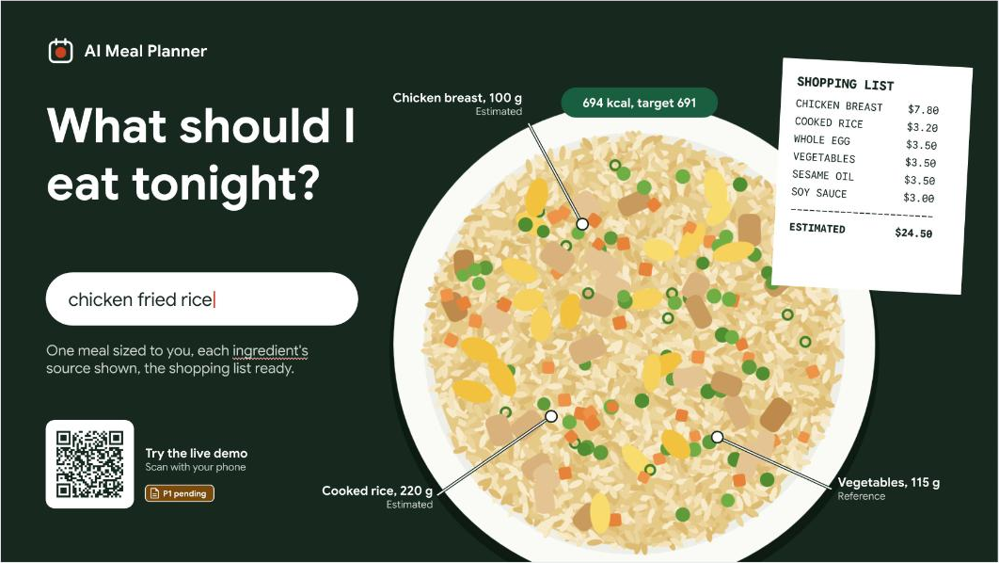

## Slide 2. Executive summary

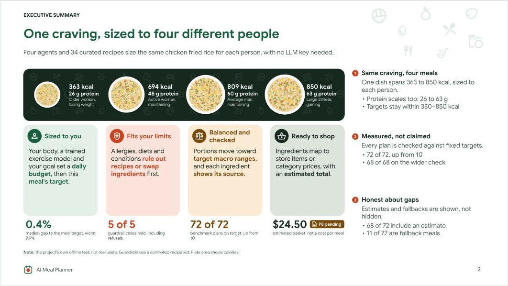

## Slide 3. Agenda

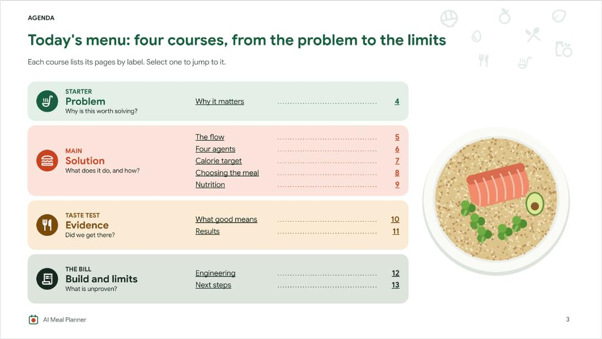

## Slide 4. Why it matters

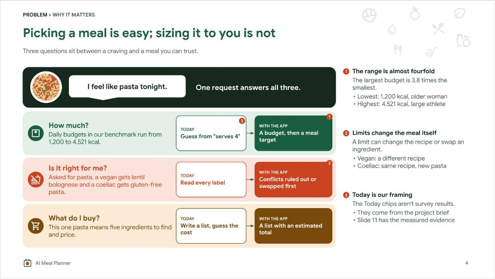

## Slide 5. The flow

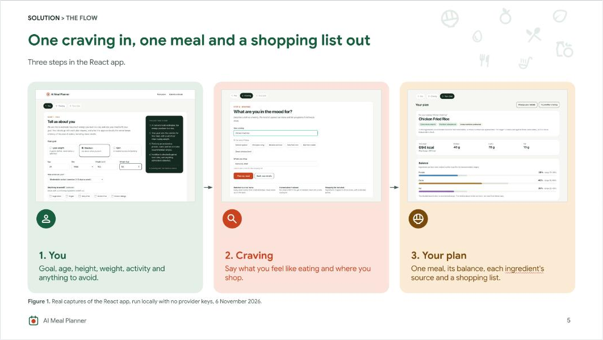

## Slide 6. Four agents

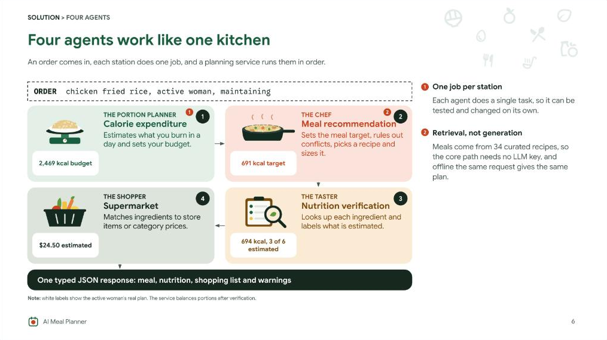

## Slide 7. Calorie target

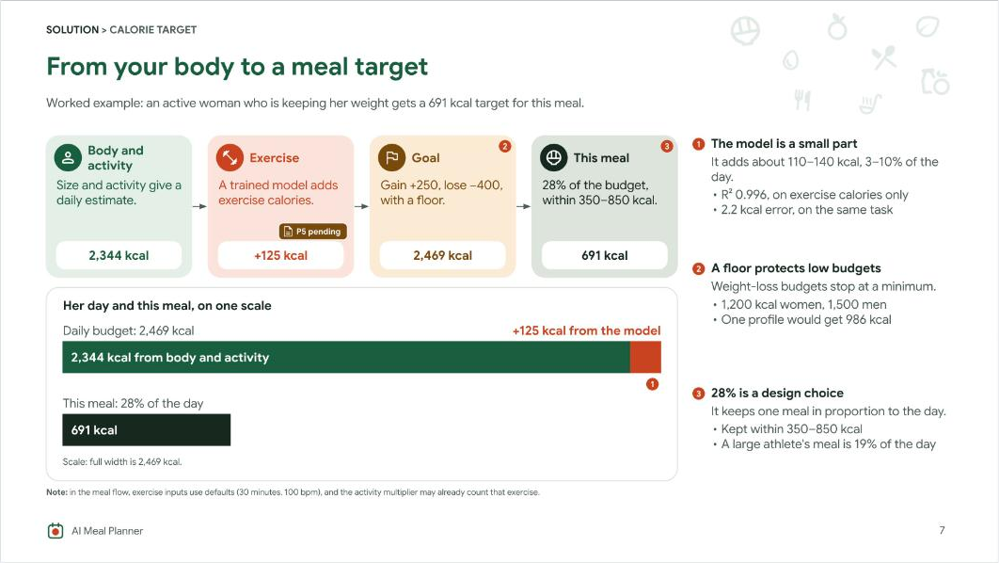

## Slide 8. Choosing the meal

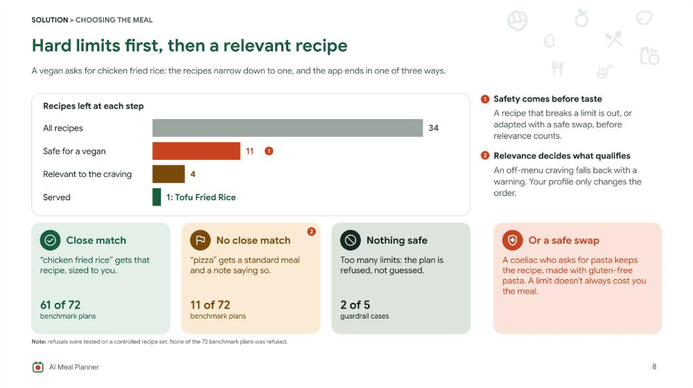

## Slide 9. Nutrition

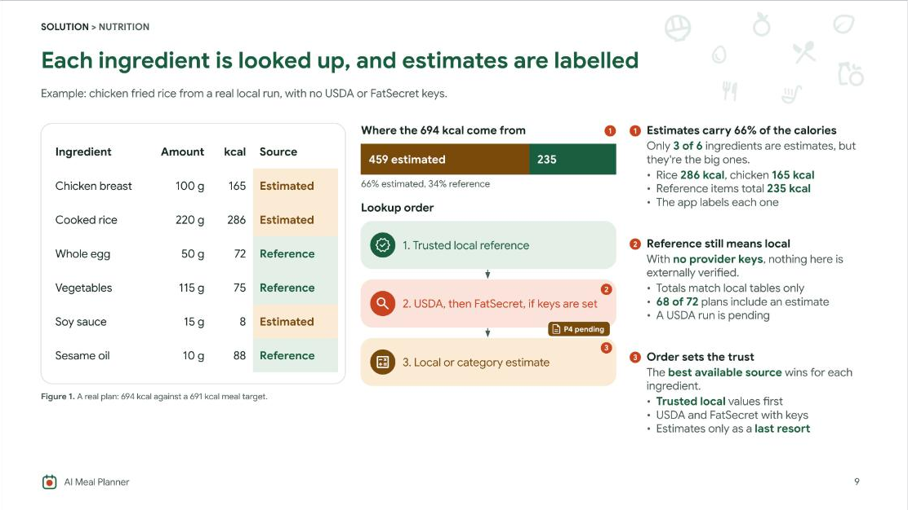

## Slide 10. What good means

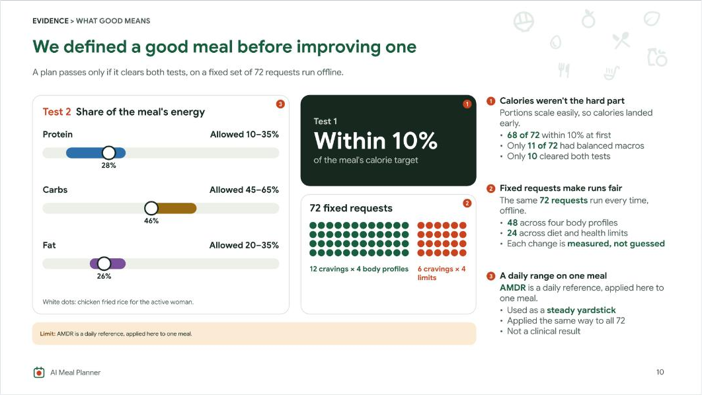

## Slide 11. Results

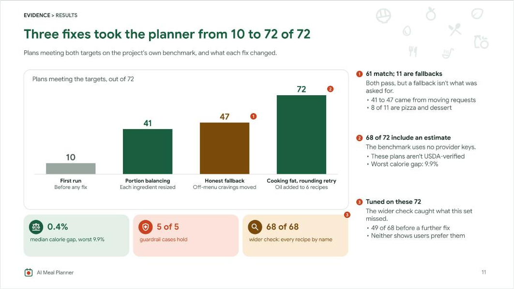

## Slide 12. Architecture

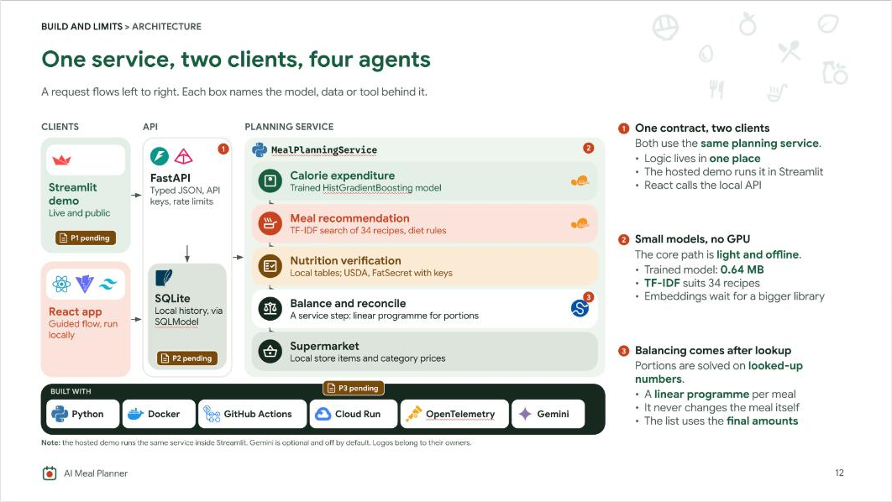

## Slide 13. Engineering

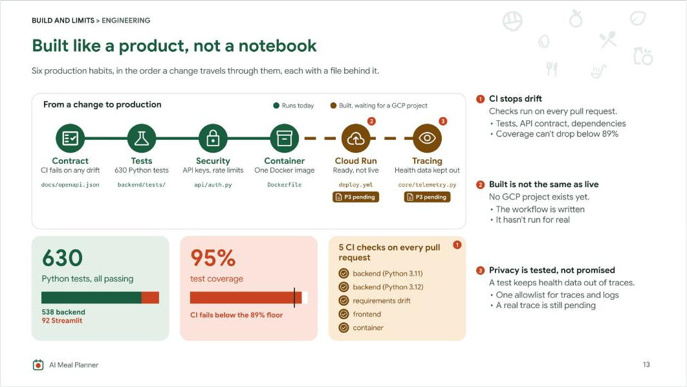

## Slide 14. Limits

## Slide 15. Pending tasks

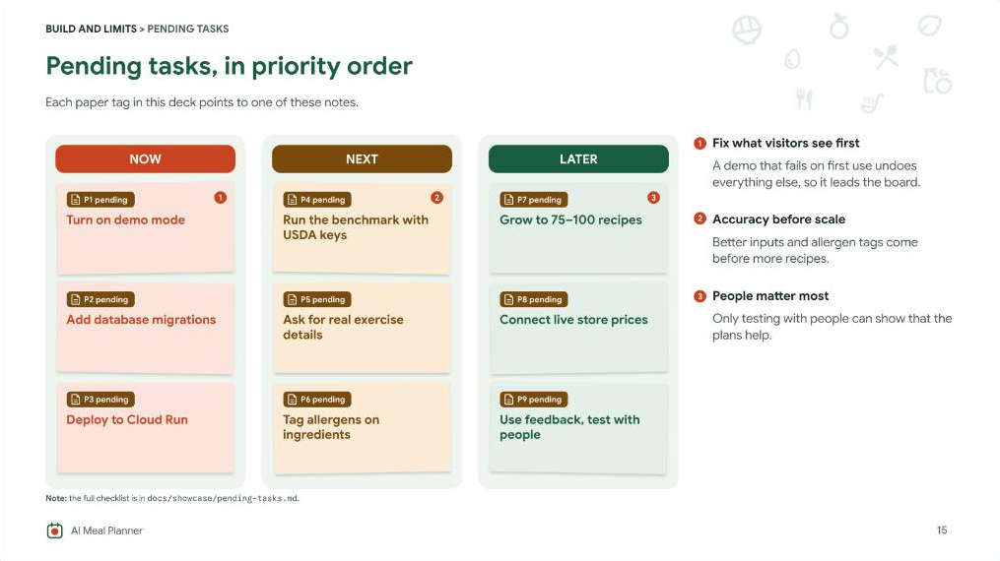

## Slide 16. Close

